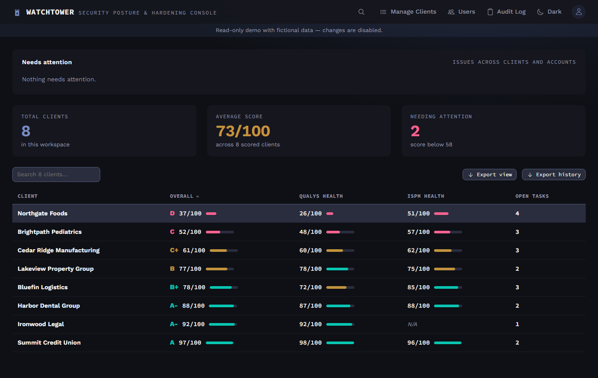
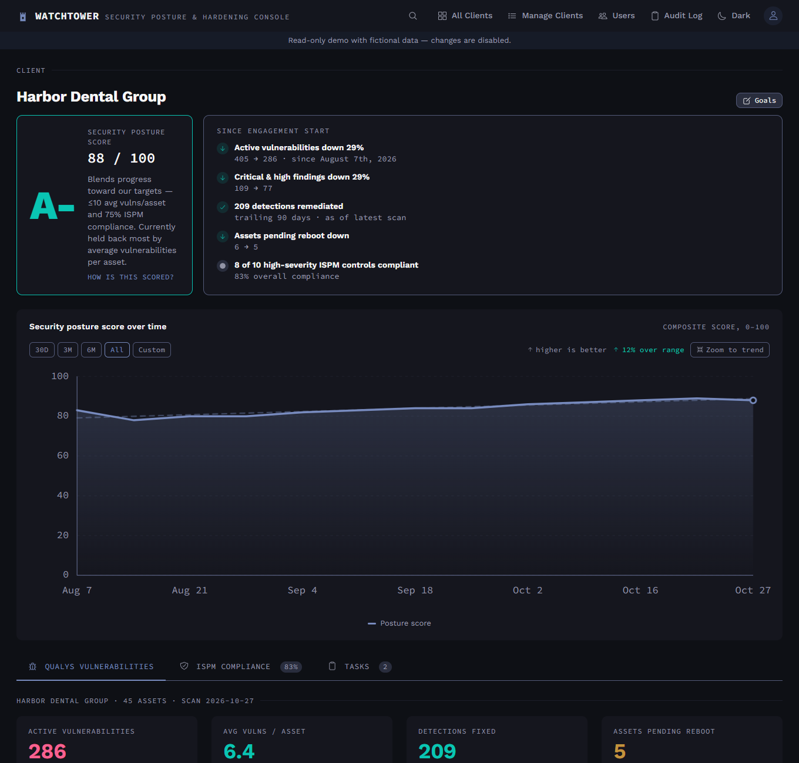

# Watchtower

A multi-user security posture dashboard for managed service providers. It blends **Qualys**
vulnerability scan data and **Huntress ISPM** control compliance into one letter grade per client,
tracks it over time, and gives every client a kanban board for hardening work.

> Not affiliated with, endorsed by, or sponsored by Qualys or Huntress. Product names belong to
> their owners. Everything in the demo is fictional.





## Live demo

**https://YOUR-DEMO-URL** — read-only, fictional clients. The sign-in page shows the demo login
(`demo@watchtower.dev` / `watchtower-demo`) and fills it in for you.

## What it does

- **Triage at a glance.** The Overview leads with a "needs attention" digest (failing syncs, stale
  scans, locked accounts), then every client ranked worst-first with its grade, Qualys health and
  ISPM health.
- **One posture score per client.** A composite of vulnerability health (active vulnerabilities per
  asset against a target, blended with the trend) and severity-weighted ISPM compliance, shown as a
  grade and charted over time. Targets can be set per client.
- **Client detail.** Latest-scan severity breakdown, detections fixed by age, the top
  vulnerabilities by affected assets (with hand-written notes that carry across clients), the ISPM
  control list, and a plain-language "since engagement start" narrative.
- **Hardening board.** A kanban of tasks per client, linkable to the ISPM control they fix.
- **Data in.** A Weekly Update form for scan counts and control compliance, plus an optional daily
  Qualys API sync that pulls assets, detections and severities.
- **Data out.** CSV export of the current view, of one client's controls, of the audit log, and of
  the full scan-by-scan history for every client.
- **Admin.** User management, archived clients, a persisted audit trail, and TOTP two-factor
  enrollment with recovery codes.
- Command palette search (Ctrl+K), light and dark themes, keyboard-accessible, AA-contrast tokens.

## Architecture

```
apps/api        Express + TypeScript API, Prisma ORM, session auth
apps/web        React + TypeScript + Vite + Tailwind frontend
packages/shared Scoring logic and types shared by both
```

One Postgres database and one Node service. In production the API also serves the built React app,
so there is a single container to deploy. The scoring rules live in `packages/shared` and are unit
tested; the API and the browser both use the same functions, so a grade can't disagree with its
chart.

Security basics: server-side sessions in Postgres with idle and absolute timeouts, bcrypt, per-IP
rate limits and per-account lockout, mandatory TOTP for every account (admins can waive it per user),
a custom-header CSRF check on every write, and helmet's CSP.

## Run it locally

Needs Node 20+ and Docker.

```bash
npm install
cp .env.example .env            # set SESSION_SECRET, MFA_ENCRYPTION_KEY, ADMIN_EMAIL, ADMIN_PASSWORD
docker compose up -d db         # Postgres on localhost:5432 (docker-compose.override.yml)
npm run prisma:migrate          # apply the committed migrations
npm run seed:admin              # create the first admin
npm run seed:demo               # optional: fictional clients with 12 weeks of history
npm run dev:api                 # API on :4000
npm run dev:web                 # Vite on :5173, proxies /api to the API
npm test                        # shared + API unit tests
```

## Deploying

### Docker (self-hosted)

```bash
cp .env.example .env            # set POSTGRES_PASSWORD, SESSION_SECRET, MFA_ENCRYPTION_KEY, ...
docker compose up -d --build    # app on :4000, migrations applied on boot
```

If nothing in front of it terminates HTTPS, set `COOKIE_SECURE=false` in `.env` — session cookies
are `Secure` by default, so over plain HTTP sign-in would appear to succeed and every later request
would look signed out. Backup and restore notes are in [docs/backups.md](docs/backups.md).

### Docker demo stack

`docker-compose.demo.yml` runs a read-only demo with fictional data: copy `.env.demo.example` to
`.env.demo`, then `docker compose -f docker-compose.demo.yml --env-file .env.demo up -d --build`
(app on :4100). `DEMO_SEED=1` seeds the demo user and clients on boot, refuses every write except
sign-in/out, and keeps the data fresh without a scheduler (the first signed-in request each day
appends a new scan). Because the shared demo login is an admin who can read the Audit Log, demo
mode also keeps the audit trail free of anything that identifies a visitor: no IP addresses, and
no emails from failed sign-ins.

### Free public demo (Vercel + Neon)

This is how the live demo runs. The Express app is one serverless function (`api/index.mjs`) next
to the static frontend, with a free Neon Postgres behind it.

1. Create a Neon project. You need its **direct** connection string and its **pooled** one.
2. `cp .env.demo.example .env.demo`, set `DATABASE_URL` to the direct string, then run
   `npm run demo:setup` once from the repo root (after `npm install`). It generates the Prisma
   client, applies migrations and seeds the demo user and clients.
3. Import the repo into Vercel and set these environment variables:
   `DATABASE_URL` (the pooled string plus `&pgbouncer=true&connection_limit=1`), `SESSION_SECRET`,
   `MFA_ENCRYPTION_KEY`, `DEMO_SEED=1`, `VITE_DEMO_EMAIL`, `VITE_DEMO_PASSWORD`.
4. Deploy. Vercel's Hobby plan is for non-commercial use, which a portfolio demo is.

## Migrations

The schema is managed with tracked Prisma migrations (`apps/api/prisma/migrations/`).
`docker-entrypoint.sh` runs `prisma migrate deploy` on every boot; it only applies committed
migrations and never drops anything on drift. To change the schema, edit `schema.prisma`, run
`npx prisma migrate dev --name <change> --schema=apps/api/prisma/schema.prisma` against a scratch
database, and commit the generated folder.

## Not included

- **SSO.** Email and password with TOTP; Entra ID / OIDC would be the natural next step.
- **Per-control ISPM history.** ISPM is stored as a point-in-time control list plus an aggregate
  compliance series, so you can chart the percentage but not individual controls flipping.
- **Browser-level end-to-end tests.** Scoring, the Qualys parsing, export shaping and demo-mode
  gating have unit tests; a Playwright suite would be the next addition.

## License

[MIT](LICENSE)
